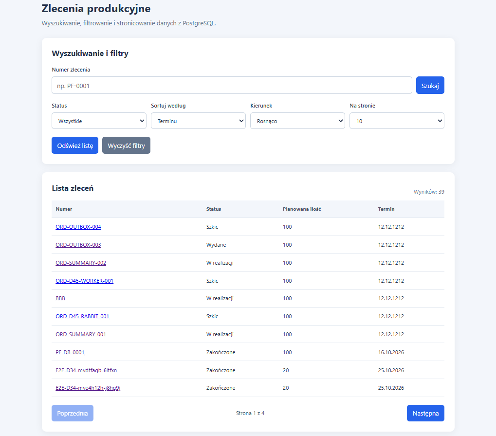
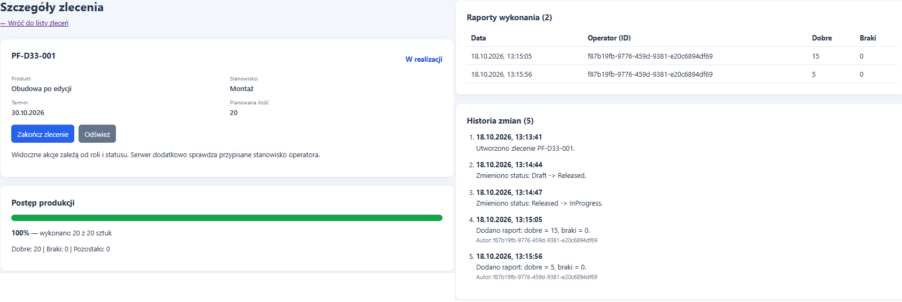
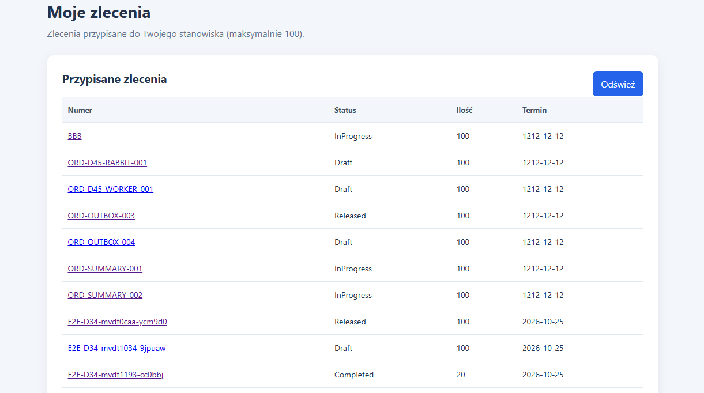
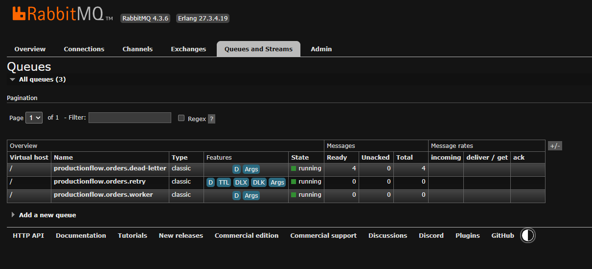
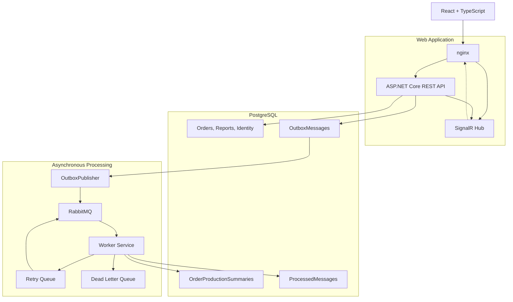
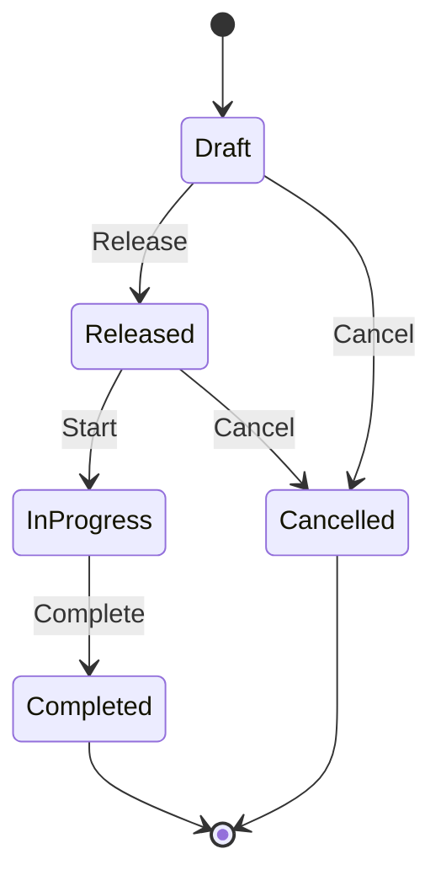

# ProductionFlow

**Full-stack production order management system built with
.NET 10, React, PostgreSQL and RabbitMQ.**

ProductionFlow is a portfolio project demonstrating the
development of a business web application using modern
backend, frontend and messaging technologies.

The application allows users to plan production orders,
manage their execution, report production results and
track progress.

Beyond basic CRUD operations, the project demonstrates
authentication, authorization, transactional consistency,
asynchronous processing, real-time updates and automated
testing.

## Table of Contents

- [Screenshots](#screenshots)
- [Main Features](#main-features)
- [Technology Stack](#technology-stack)
- [Architecture](#architecture)
- [Production Workflow](#production-workflow)
- [Quick Start](#quick-start)
- [Demo Scenario](#demo-scenario)
- [Reliable Messaging](#reliable-messaging)
- [Testing and CI](#testing-and-ci)
- [Project Structure](#project-structure)
- [Limitations](#limitations)

## Screenshots

### Production Orders



### Order Details and Progress



### Operator View



### RabbitMQ Queues



## Main Features

### Production Order Management

- Create and manage production orders
- Select products and production work centers
- Search, filter, sort and paginate orders
- Manage production order status transitions
- Record good and scrap quantities
- Track production progress and execution history
- Receive real-time updates using SignalR

### Authentication and Authorization

Authentication is implemented using ASP.NET Core Identity,
cookie authentication and CSRF protection.

The application supports three roles:

| Role | Responsibilities |
|---|---|
| Admin | Administration and production operations |
| Planner | Creating, releasing and managing orders |
| Operator | Executing orders at assigned work centers |

Authorization is enforced by the backend.

### Data Consistency

- Business validation
- PostgreSQL transactions
- Protection against concurrent modifications
- HTTP 409 conflict responses
- Production order change history
- Idempotent background processing

### Production Summaries

A background worker maintains production summaries
containing planned, good, scrap and remaining quantities.

The backend exposes:

- `GET /api/order-summaries`
- `GET /api/order-summaries/export.csv`

These endpoints are available to Admin and Planner roles.

The summary data is eventually consistent because it
is updated asynchronously.

## Technology Stack

| Area | Technologies |
|---|---|
| Backend | C#, .NET 10, ASP.NET Core REST API |
| Database | PostgreSQL 18, Entity Framework Core |
| Authentication | ASP.NET Core Identity, Cookies, CSRF |
| Frontend | React, TypeScript, Vite, React Router |
| Real-time | ASP.NET Core SignalR |
| Messaging | RabbitMQ 4.3, Worker Service |
| Reliability | Transactional Outbox, Publisher Confirms, Retry, DLQ |
| Logging | Serilog |
| Testing | xUnit, Testcontainers, Playwright |
| Infrastructure | Docker Compose, nginx, GitHub Actions |

## Architecture



The API manages production orders and persists business
data in PostgreSQL.

Order changes can produce events stored in the
Transactional Outbox within the database transaction.

OutboxPublisher sends pending events to RabbitMQ.
Worker Service consumes them and updates production
summaries.

SignalR provides real-time notifications to connected
clients. The React frontend refreshes relevant data
when order changes are received.

## Production Workflow

A production order moves through the following states:



Execution reports contain incremental quantities of
good and scrap units.

An order can be completed only when the total reported
quantity matches the planned quantity.

Example:

| Metric | Quantity |
|---|---:|
| Planned | 100 |
| Good | 95 |
| Scrap | 5 |
| Total reported | 100 |
| Progress | 100% |

The business logic prevents reporting more units than
the production plan.

## Quick Start

### Requirements

- Docker Desktop
- Docker Compose

The application can be started without installing
PostgreSQL, RabbitMQ or the .NET SDK locally.

### 1. Clone the repository

```powershell
git clone https://github.com/adambartczak-dev/ProductionFlow.git
cd ProductionFlow
```

### 2. Configure environment variables

Create `.env` in the repository root using `.env.example`.

```powershell
Copy-Item .env.example .env
```

Edit `.env` and configure:

- PostgreSQL password
- Admin, Planner and Operator demo passwords
- RabbitMQ password

Use sufficiently strong passwords for ASP.NET Core
Identity demo accounts.

Never commit `.env` or real credentials.

### 3. Start all services

```powershell
docker compose up -d --build --wait
```

Docker Compose starts six main services:

- PostgreSQL
- ASP.NET Core API
- React frontend served by nginx
- RabbitMQ
- Worker Service
- OutboxPublisher

Development database migrations and demonstration
accounts are initialized automatically.

Check the running containers:

```powershell
docker compose ps
```

### 4. Open the application

| Service | URL |
|---|---|
| Web application | http://localhost:3000 |
| API health check | http://localhost:8080/health |
| RabbitMQ Management | http://localhost:15672 |

PostgreSQL is also accessible locally on port `54330`.

### 5. Demonstration accounts

| Role | Email |
|---|---|
| Admin | admin@productionflow.local |
| Planner | planner@productionflow.local |
| Operator | operator@productionflow.local |

Passwords are configured in `.env`.

Demo products and work centers are created during
development initialization if the catalogs are empty.

The Operator account requires a work center assignment
before performing work-center-specific operations.

### 6. Stop the application

```powershell
docker compose down
```

This preserves PostgreSQL and RabbitMQ data volumes.

**Warning:** `docker compose down -v` deletes named
volumes and their stored data.

## Demo Scenario

The following scenario demonstrates the complete
production order lifecycle using the Admin account.

1. Log in to ProductionFlow.
2. Open **Nowe zlecenie**.
3. Select an existing product and work center.
4. Create an order with a planned quantity of 100.
5. Open the order details.
6. Release the order for production.
7. Start production.
8. Submit a report with 57 good units and 3 scrap units.
9. Verify that progress is 60%.
10. Submit another report with 38 good units and 2 scrap units.
11. Verify that progress reaches 100%.
12. Complete the order.
13. Inspect the execution reports and order history.

Expected result:

- Status: `Completed`
- Planned quantity: `100`
- Good quantity: `95`
- Scrap quantity: `5`
- Progress: `100%`

The workflow also demonstrates server-side validation
and persistence across page reloads.

## Reliable Messaging

ProductionFlow implements an asynchronous event
processing pipeline:

1. The API saves a production order change.
2. The event is saved in the PostgreSQL Outbox.
3. OutboxPublisher publishes the event to RabbitMQ.
4. Publisher Confirms verify broker acknowledgment.
5. Worker Service consumes the event.
6. ProcessedMessages protects against duplicate events.
7. The worker updates production summaries.

The processing logic uses database transactions.

The messaging design uses at-least-once delivery
semantics, so duplicate deliveries may occur.

Idempotent processing prevents the same event from
being applied multiple times.

### Failure Handling

- Transient processing failures use a Retry Queue.
- Retry attempts are limited.
- Messages that cannot be processed are moved to
  the Dead Letter Queue.

RabbitMQ demonstration commands:

```powershell
docker compose run --rm publisher DemoOrderChanged
docker compose run --rm publisher DemoTransientFailure
docker compose run --rm publisher DemoPermanentFailure
docker compose run --rm publisher DemoInvalidJson
```

Inspect logs:

```powershell
docker compose logs worker --tail 80
docker compose logs outbox-publisher --tail 80
```

RabbitMQ Management is available at:

http://localhost:15672

## Testing and CI

### Backend Tests

The .NET solution contains unit and integration tests
using xUnit.

Integration tests use Testcontainers with PostgreSQL.

Run from the repository root:

```powershell
dotnet test ProductionFlow.sln
```

Docker Desktop is required for Testcontainers.

### Frontend Checks

Run from the `frontend` directory:

```powershell
npm ci
npm run lint
npm run build
```

### End-to-End Tests

Playwright tests cover authentication, permissions
and production order workflows.

Configure local test account passwords in:

`frontend/.env.e2e.local`

Install the Chromium browser if necessary:

```powershell
npx playwright install chromium
```

When the application is running through Docker Compose,
execute from the `frontend` directory:

```powershell
$env:PF_E2E_TARGET = "docker"
npx playwright test
Remove-Item Env:PF_E2E_TARGET
```

E2E tests create demonstration orders in the database.

### Continuous Integration

GitHub Actions validates:

- .NET build
- Unit tests
- Integration tests
- Frontend linting
- React and TypeScript build
- Docker Compose startup
- Playwright E2E tests

The workflow is defined in:

`.github/workflows/ci.yml`

## Project Structure

```text
ProductionFlow/
├── src/
│   ├── ProductionFlow.Api/
│   ├── ProductionFlow.Messaging/
│   ├── ProductionFlow.Worker/
│   ├── ProductionFlow.OutboxPublisher/
│   └── ProductionFlow.Publisher/
├── tests/
│   ├── ProductionFlow.UnitTests/
│   └── ProductionFlow.IntegrationTests/
├── frontend/
│   ├── src/
│   └── e2e/
├── docs/
│   ├── requirements.md
│   └── screenshots/
├── scripts/
│   └── measure-api.ps1
├── .github/
│   └── workflows/
│       └── ci.yml
├── compose.yaml
├── ProductionFlow.sln
└── README.md
```

## Limitations

ProductionFlow is a local demonstration and portfolio
application, not a production-deployed MES platform.

Current limitations include:

- Development authentication over local HTTP
- Demo accounts configured through environment variables
- No production deployment or cloud hosting
- No high-availability configuration
- Production summaries and CSV export exposed through
  REST API rather than a dedicated React reporting page

A production deployment would require additional
security hardening, TLS, secret management, monitoring,
backup procedures and infrastructure configuration.